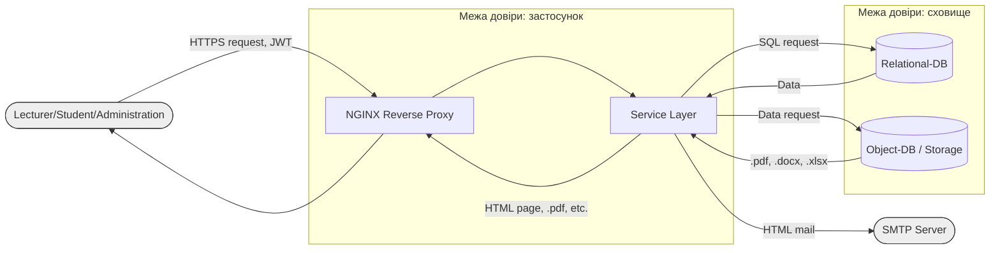

# Модель загроз: система електронного документообігу кафедри

**Варіант:** 14  ·  **Здобувач:** Новосьолов Павло Андрійович  ·  **Група:** ІП-31

## 1. Опис системи та активи

Система необхідна для збору, обробки, зберігання та отримання доступу документів університетської кафедри. Користувачами виступають викладачі, завідувач кафедри, заступник завідуючого кафедри, адміністрація факультету, студенти. Система має інтеграцію SMTP сервера для надсилання сповіщень про нові документи та оновлення статусів документів для користувачів з достатнім рівнем доступу.

Функціональність: 
- Завантаження документів кафедри
- Обговорення
- Підписання 
- Розмежування прав доступу
- Зберігання, видалення документів
- Журналювання дій
- Генерація звітів

| Актив | Тип | Цінність (К/Ц/Д) |
|-------|-----|------------------|
| Екзаменаційні матеріали | Файли | В/В/В |
| Персональні документи користувачів (скан паспорта і т.д.) | Файли | В/В/С |
| Протоколи засідань кафедри | Файли | С/В/Н |
| Заяви, навчально-методичні матеріали | Документ | С/В/С |
| Службові секрети (паролі, токени, тощо) | Облікові дані / Секрети | В/В/В |
| Журнал аудиту дій користувачів | Логи | Н/В/С |
| Сервіс обслуговування | Сервіс | С/В/В |


## 2. Діаграма потоків даних



## 3. Загрози за STRIDE

| № | Елемент/потік | Категорія STRIDE | Опис загрози | Порушувана властивість |
|---|---------------|------------------|--------------|------------------------|
| 1 | user --> proxy | I | Витік JWT викладача | Конфіденційність |
| 2 | service | I | Користувач через URL або Query параметри GET запиту отримує доступ до чужих даних (IDOR) | Конфіденційність |
| 3 | service | I | Надто детальний вивід помилки розкриває внутрішню структуру системи | Конфіденційність |
| 4 | docs | I | Доступ до файлів через прямий URL без авторизації | Конфіденційність |
| 5 | db | I | Витік даних через SQL Injection | Конфіденційність |
| 6 | service --> SMTP | I | Витік посилання оновлення пароля | Конфіденційність |
| 7 | service | S | Брутфорс пароля | Автентичність |
| 8 | user --> proxy | D | DDoS атака | Доступність |
| 9 | service | R | Відсутність журналювання на деструктивні дії | Неспростовність |
| 10 | service | T | Завантаження скрипта який виконуватиметься | Цілісність |
| 11 | proxy | S | Використання невалідного JWT що не перевіряється | Автентичність |
| 12 | docs | T | Пряма підміна документа в сховищі в обхід сервісу | Цілісність |


## 4. Оцінювання ризиків (CVSS / матриця)

| № загрози | Вектор CVSS | Базова оцінка | Імовірність | Вплив | Ранг ризику |
|-----------|-------------|---------------|-------------|-------|-------------|
| 1 | CVSS:3.1/AV:N/AC:L/PR:N/UI:N/S:U/C:H/I:N/A:N | 7.5 | Середня | Високий | Високий |
| 2 | CVSS:3.1/AV:N/AC:L/PR:L/UI:N/S:U/C:H/I:N/A:N | 6.5 | Висока | Високий | Середній |
| 3 | CVSS:3.1/AV:N/AC:L/PR:N/UI:N/S:U/C:L/I:N/A:N | 5.3 | Висока | Низький | Середній |
| 4 | CVSS:3.1/AV:N/AC:L/PR:N/UI:N/S:U/C:H/I:N/A:N | 7.5 | Середня | Високий | Високий |
| 5 | CVSS:3.1/AV:N/AC:L/PR:N/UI:N/S:U/C:H/I:H/A:N | 9.1 | Середня | Критичний | Критичний |
| 6 | CVSS:3.1/AV:N/AC:H/PR:N/UI:N/S:U/C:H/I:N/A:N | 5.9 | Низька | Високий | Середній |
| 7 | CVSS:3.1/AV:N/AC:L/PR:N/UI:N/S:U/C:H/I:L/A:N | 8.2 | Середня | Високий | Високий |
| 8 | CVSS:3.1/AV:N/AC:L/PR:N/UI:N/S:U/C:N/I:N/A:H | 7.5 | Середня | Високий | Високий |
| 9 | CVSS:3.1/AV:N/AC:L/PR:L/UI:N/S:U/C:N/I:L/A:N | 4.3 | Середня | Низький | Середній |
| 10 | CVSS:3.1/AV:N/AC:L/PR:L/UI:N/S:U/C:H/I:H/A:H | 8.8 | Низька | Критичний | Високий |
| 11 | CVSS:3.1/AV:N/AC:L/PR:N/UI:N/S:U/C:H/I:H/A:N | 9.1 | Низька | Критичний | Критичний |
| 12 | CVSS:3.1/AV:L/AC:L/PR:L/UI:N/S:U/C:N/I:H/A:N | 5.5 | Низька | Середній | Середній |

## 5. Реєстр ризиків і рішення

| № | Ризик | Рішення | Контрзахід (простими словами) | Залишковий ризик |
|---|-------|---------|-------------------------------|------------------|
| 1 | Перехоплення токена (JWT) викладача в мережі | Зменшити | Використовувати тільки шифрований HTTPS, зберігати токен у безпечних cookie (прапорець `HttpOnly`, щоб його не вкрав скрипт), обмежити час дії токена 15 хвилинами | Низький |
| 2 | Студент підставляє чужий ID і бачить чужий документ (IDOR) | Зменшити | Сервер перевіряє права користувача перед кожним відкриттям файлу; замість простих номерів 1, 2, 3 використовувати UUID v4 | Низький |
| 3 | Помилка програми показує технічні деталі та код системи | Усунути | Вимкнути режим налагодження (DEBUG) на робочому сервері; показувати користувачеві лише зрозуміле повідомлення | Низький |
| 4 | Прямий доступ до файлу за посиланням без входу в систему | Усунути | Заборонити пряме скачування файлів з папки сервера; видавати документ тільки через бекенд після перевірки логіну та прав | Низький |
| 5 | Злом бази даних через лапки та SQL-команди в полі пошуку (SQLi) | Усунути | Використовувати параметризовані запити (Prepared Statements) або ORM. Тоді база сприймає введений текст тільки як текст, а не як команду | Низький |
| 6 | Перехоплення листа з посиланням на скидання пароля | Зменшити | Посилання для відновлення пароля діє лише один раз і не довше 10 хвилин; пошта відправляється через зашифроване з'єднання | Низький |
| 7 | Підбір паролів автоматичними програмами (брутфорс) | Зменшити | Тимчасово блокувати вхід після 5 невдалих спроб; вимагати складні паролі та додати підтвердження кодом (2FA) для викладачів | Низький |
| 8 | Падіння сайту через величезну кількість фальшивих запитів (DDoS) | Передати | Делегувати захист зовнішньому сервісу (Cloudflare або університетський фаєрвол), оскільки власний сервер кафедри такий наплив не витримає | Середній |
| 9 | Неможливо довести, хто видалив документ (немає запису дій) | Зменшити | Вести журнал аудиту: автоматично записувати хто, коли і що зробив; заборонити видаляти чи редагувати цей журнал | Низький |
| 10 | Завантаження шкідливого скрипта (вірусу) замість PDF-документа | Усунути | Дозволити завантажувати тільки файли з розширенням `.pdf` та `.docx`, перевіряти їхній реальний вміст і заборонити серверу запускати їх як програми | Низький |
| 11 | Використання підробленого токена без реального підпису | Усунути | Сервер зобов'язаний суворо перевіряти цифровий підпис кожного токена і відхиляти будь-які спроби передати токен без перевірки | Низький |
| 12 | Зміна файлів напряму на жорсткому диску сервера | Прийняти | Доступ до сервера захищено звичайним паролем адміністратора Linux. Купувати наддорогі спеціальні диски для кафедри немає грошей і сенсу. Захист — щоденні резервні копії (бекапи). | Низький |


## 6. Дерево атак для найкритичнішої загрози

Найкритичнішою загрозою обрано **Загрозу №5 (SQL Injection)** з базовою оцінкою CVSS **9.1 (Критичний)**, оскільки вона дозволяє зловмиснику неавторизовано обійти всі механізми автентифікації та отримати повний доступ до бази даних (як до конфіденційних документів і персональних даних, так і до хешів паролів адміністраторів).

### Текстове подання дерева атак:

```text
Мета: Несанкціоновано отримати конфіденційні документи та облікові записи через SQLi
  OR
  ├── 1. Експлуатація поля повнотекстового пошуку документів (GET /api/documents/search?q=)
  │     AND (Контрзахід: використовувати параметризовані запити або ORM)
  │     ├── Виявити конкатенацію користувацького вводу у рядок SQL-запиту
  │     ├── Підібрати кількість стовпців та типи даних для об'єднання (UNION SELECT)
  │     └── Вивантажити таблицю користувачів (users) та таблицю документів (documents)
  ├── 2. Експлуатація сортування списку документів (GET /api/documents?sort=)
  │     AND (Контрзахід: використовувати параметризовані запити або ORM)
  │     ├── Виявити пряму підстановку назви колонки в умову ORDER BY
  │     └── Застосувати сліпу ін'єкцію за часом (pg_sleep) для посимвольного читання хешів паролів
  └── 3. Експлуатація збереження метаданих через заголовки запиту
        AND (Контрзахід: заборона виконання скриптів при генерації звітів)
        ├── Впровадити шкідливий корисний навантажувач у поле назви завантажуваного файлу
        └── Дочекатися обробки фоновою службою генерації звітів кафедри, яка виконує непараметризований запит
```

## 7. Висновки та аналіз результатів

У ході виконання лабораторної роботи було побудовано повноцінну модель загроз для веб-системи електронного документообігу (СЕД) кафедри відповідно до індивідуального Варіанта 14 (пріоритетна категорія — **Information Disclosure**).

### Аналіз отриманих результатів:

1. **Розподіл загроз за методологією STRIDE:**
   - **Information disclosure (Конфіденційність):** 6 загроз (50.0%) — №1, 2, 3, 4, 5, 6;
   - **Spoofing (Автентичність):** 2 загрози (16.7%) — №7, 11;
   - **Tampering (Цілісність):** 2 загрози (16.7%) — №10, 12;
   - **Denial of service (Доступність):** 1 загроза (8.3%) — №8;
   - **Repudiation (Неспростовність):** 1 загроза (8.3%) — №9.
   *Висновок:* Гіпотеза індивідуального варіанта повністю підтвердилася: категорія «Розкриття інформації» домінує над іншими. Це зумовлено специфікою кафедральної системи, яка оперує великою кількістю конфіденційних активів (екзаменаційні матеріали, рецензії дипломів, скани паспортів, облікові записи), витік яких тягне критичні академічні та правові наслідки.

2. **Найвразливіші елементи DFD та межі довіри:**
   - Найбільшу кількість загроз породив процес прикладного рівня `service` (Service Layer) — 6 загроз із 12.
   - Це безпосередньо обумовлено його положенням: процес розташований на межі довіри `TB1` (Застосунок) і першим приймає неперевірені зовнішні дані з недовіреного інтернету через проксі-сервер, виконує їх парсинг та передає команди у високодовірену зону сховищ `TB2` (БД та сховище файлів).

3. **Обґрунтування оцінки найкритичнішої загрози (SQL Injection — CVSS 9.1):**
   - Загроза №5 отримала найвищий бал базової оцінки через поєднання високої експлуатованості та руйнівного впливу:
     - `AV:N` (дистанційна атака через мережу Інтернет);
     - `AC:L` (низька складність автоматизованої експлуатації);
     - `PR:N` (можливість атаки без попередньої авторизації);
     - `UI:N` (не потребує взаємодії з боку жертви);
     - `C:H` та `I:H` (повна втрата конфіденційності та цілісності: зловмисник отримує дамп усіх документів кафедри та таблиці користувачів із хешами паролів).

4. **Порівняння системних і точкових контрзаходів (що перекриває найбільше загроз):**
   - **Для дерева атак: Параметризовані запити (Prepared Statements або ORM).**
     - *Що перекриває:* Перекриває **всі 3 гілки** дерева атак SQL-ін'єкції (атаку через пошук, через сортування та через ім'я завантаженого файлу).
     - *Чому це краще за точкові заходи:* Точковий захід — це намагатися вручну вирізати лапки або підозрілі слова з тексту. Але хакери легко обходять такі фільтри іншим кодуванням. Системний захист (Prepared Statements) передає дані окремо від самої команди. База даних виконує шаблон, а текст користувача сприймає виключно як текст. Це раз і назавжди робить атаку неможливою у будь-якому полі сайту.
   - **Для реєстру ризиків: Централізована перевірка прав доступу перед кожним файлом разом із випадковими ID (UUID).**
     - *Що перекриває:* Одночасно повністю нейтралізує загрозу **№2** (підміна ID у посиланні / IDOR) та загрозу **№4** (пряме скачування файлів без пароля).
     - *Чому це краще за точкові заходи:* Точковий захист — це коли програміст у кожній окремій функції вручну пише: «перевір, чий це файл». Хтось обов'язково забуде це зробити в новому місці. Системний захист — це єдине загальне правило для всього сайту: будь-який запит до файлу автоматично перевіряє права користувача, а в посиланнях замість простих чисел 1, 2, 3 використовуються випадкові довгі коди, які неможливо вгадати.

5. **Обґрунтування прийняття ризику (№12):**
   - Для загрози несанкціонованої модифікації файлів безпосередньо на диску сервера обрано стратегію «прийняти».
   - Доступ до файлової системи захищено штатними механізмами розмежування прав ОС Linux (DAC) для системного облікового запису процесу. Впровадження дорогих апаратних накопичувачів для кафедральної системи є невиправданим. Залишковий ризик компенсується автоматичним щодобовим створенням ізольованих резервних копій (backup).
